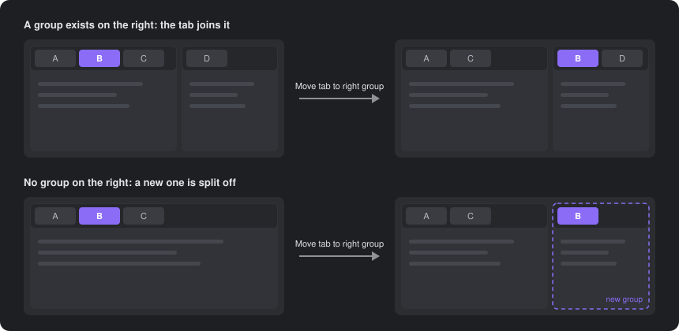

# Move Tab to Group

Move the active tab into the tab group on its left or right with one command. If there is no group on that side, a new one is split off for the tab.

Obsidian's built-in split commands open a copy of the note in a new pane, and dragging tabs between groups needs the mouse. This plugin moves the tab itself, so the original tab leaves its group and keeps its history.

## Commands

| Command | What it does |
| --- | --- |
| **Move tab to left group** | Moves the active tab to the end of the group on the left. If there is none, splits a new group off on the left. |
| **Move tab to right group** | Moves the active tab to the front of the group on the right. If there is none, splits a new group off on the right. |

Details:

- The tab stays focused after it moves.
- In nested layouts, the tab goes to the nearest group on that side.
- A tab that is alone in its group is not moved into a new group, because that would leave the layout unchanged.
- Only left and right moves are supported. If the groups on the target side are stacked vertically, the tab goes to the top one.
- Works in popout windows. Sidebars are not affected.

## Hotkeys

The plugin sets no default hotkeys. Assign your own in **Settings → Hotkeys** by searching for "Move tab to".

`Ctrl+Alt+←` and `Ctrl+Alt+→` work well. On Windows and Linux these keys are bound to **Navigate back** and **Navigate forward** by default, so remove or change those bindings first.

## Installation

From Obsidian: open **Settings → Community plugins → Browse**, search for "Move Tab to Group", then install and enable it.

Manually: download `main.js` and `manifest.json` from the [latest release](https://github.com/HanChangHun/move-tab-to-group/releases/latest) and put them in `<vault>/.obsidian/plugins/move-tab-to-group/`.

## Compatibility

Desktop only. Obsidian has no public API for moving an open tab between groups, so the plugin uses internal workspace methods. It was tested on Obsidian 1.13.7. A future Obsidian update may break it; please [open an issue](https://github.com/HanChangHun/move-tab-to-group/issues) if it stops working.

## License

[MIT](LICENSE)
